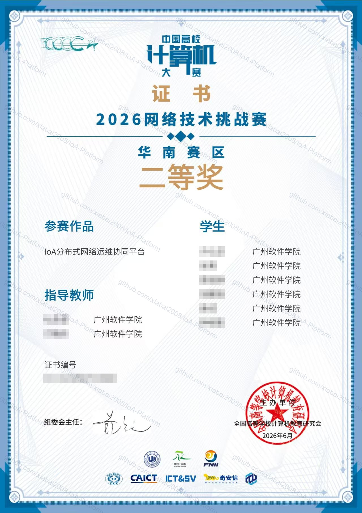
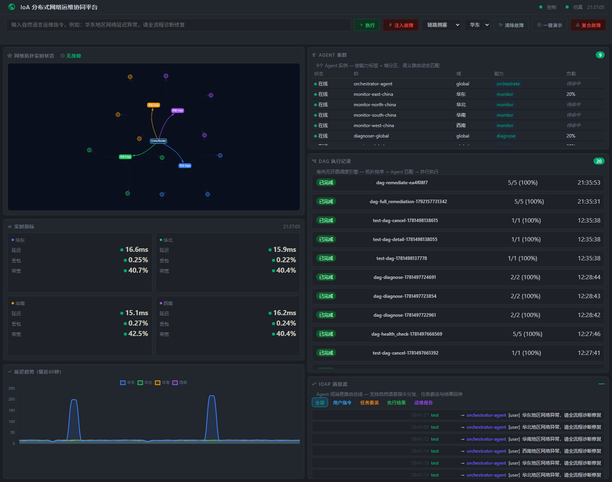
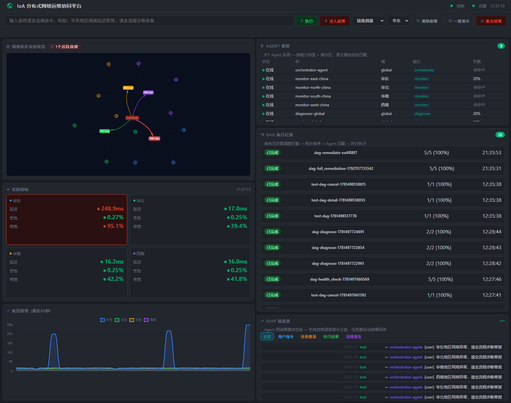
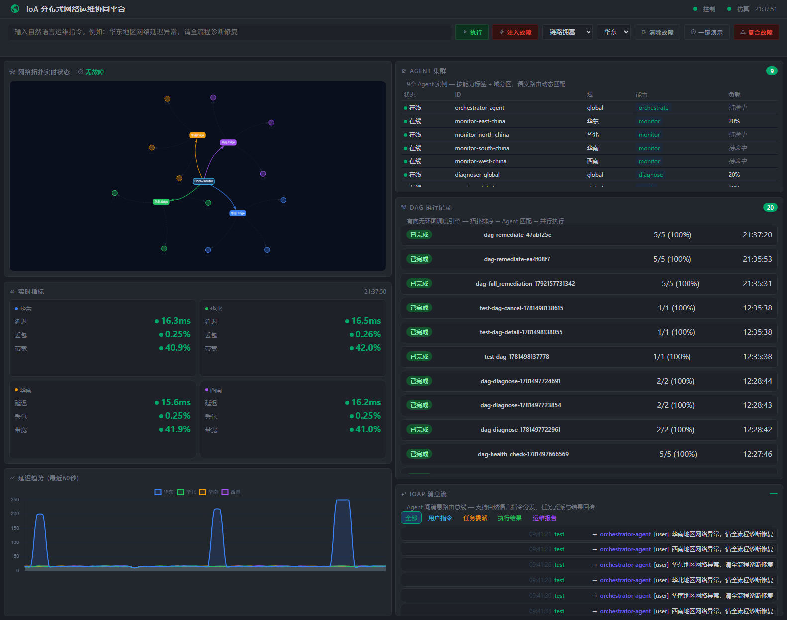
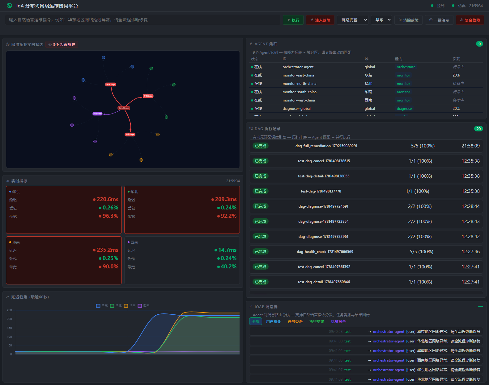
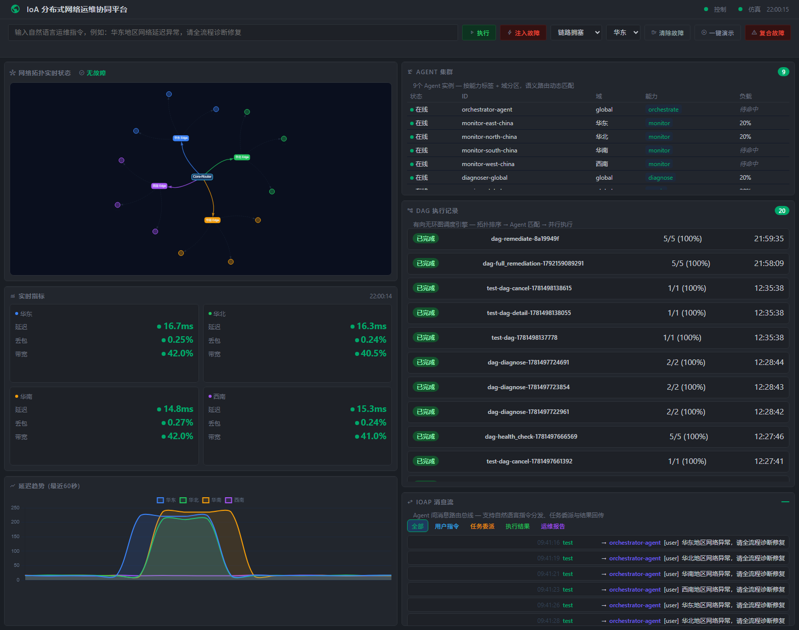

# IoA 分布式网络运维协同平台

> **Internet of Agents — 基于智能体互联网的跨域分布式任务协同调度系统**
>
> 第十一届"中国高校计算机大赛-网络技术挑战赛"（C4）B-EP1"智能体互联网创新攻关"赛项 | 2026

---

## 获奖荣誉

**第十一届"中国高校计算机大赛-网络技术挑战赛"（C4）B-EP1"智能体互联网创新攻关"赛项 · 华南赛区二等奖**

| 项目 | 内容 |
|------|------|
| 竞赛 | 第十一届"中国高校计算机大赛-网络技术挑战赛"（C4） |
| 赛项 | B-EP1 智能体互联网创新攻关 |
| 奖项 | 华南赛区二等奖（选拔赛阶段赛区奖项，按赛区参赛规模 10%/20%/40% 比例评定一、二、三等奖） |
| 参赛作品 | IoA 分布式网络运维协同平台 |
| 获奖时间 | 2026 年 6 月 |
| 主办单位 | 全国高等学校计算机教育研究会 |

> 证书扫描件已对团队人员姓名与证书编号作遮挡处理。



---

## 项目概述

本系统是一个**双层架构的智能体互联网（IoA）应用**：

- **下层（IoA中间件）**：自研通用多Agent通信与编排基础设施 — 多维加权消息路由总线、DAG任务调度引擎、Agent注册中心、闭环验证器、身份认证
- **上层（应用场景）**：分布式网络运维 — 系统包含 **9 个 Agent 实例，覆盖 5 种类型**（按分布式部署时每个实例运行在独立容器中）协同完成全网监控、故障诊断、自动修复、闭环验证：
  - **OrchestratorAgent** ×1 — 自然语言意图解析与 DAG 编排
  - **MonitorAgent** ×4 — 分域实时监控（华东/华北/华南/西南）
  - **DiagnoserAgent** ×1 — 多策略根因诊断（规则引擎 + LLM 增强）
  - **RepairerAgent** ×1 — 差异化修复执行（5 种策略：路由切换/ACL/流量整形/链路转移/服务重启）
  - **VerifyAgent** ×1 — 闭环验证（pass/retry/fail 状态机）
  - **ReporterAgent** ×1 — 全链路运维报告生成

核心创新：不是做一个网络运维工具，而是**用网络运维场景证明IoA中间件的通用性和实用性**。系统从自然语言运维指令出发，通过多维加权路由自动匹配DAG模板，实现"意图理解→任务编排→协同执行→闭环验证"的全链路自动化。

---

## 系统特性

- **自然语言驱动**：用口语化指令触发复杂运维流程，无需API调用
- **多维加权消息路由**：Agent间通信基于能力匹配而非硬编码寻址，实现松耦合
- **DAG编排引擎**：Kahn拓扑排序 + 重试策略 + 审计日志，任务图自动解析执行
- **闭环验证**：三态判定（pass/retry/fail），实时指标兜底逻辑防止无限重试
- **多域协同**：华东/华北/华南/西南四域网络拓扑，故障注入→修复全链路
- **深色科技风GUI**：拓扑图实时状态、指标仪表盘、IoAP消息流、DAG可视化

---

## 界面预览

以下截图均取自本平台**实际运行**：`python run.py` 启动后，通过 API 注入真实故障、下发真实自然语言指令触发完整 DAG 流程，并在运行中的 GUI 上截取——非设计稿、非示意图。

### 1. 控制台总览



网络拓扑、四域实时指标（延迟/丢包/带宽）、Agent 集群（9 实例 / 5 类型）、DAG 执行记录、延迟趋势与 IoAP 消息流同屏呈现。

### 2. 故障注入



向华东域注入链路拥塞：拓扑链路高亮告警（1 个活跃故障），华东延迟由基线 ~15ms 升至 213ms、带宽占用 94%，延迟趋势曲线同步抬升。

### 3. 全链路闭环修复



下发自然语言指令「华东链路拥塞，请全流程诊断修复」，Orchestrator 自动编排 `full_remediation` DAG —— monitor → diagnose → repair → verify → report 五节点依次执行，完成后活跃故障清零、华东延迟回落至 16.3ms。延迟趋势图完整记录「故障抬升 → 修复回落」全过程。

### 4. 多域并发故障



华东 / 华北 / 华南三域接入链路同时注入拥塞：拓扑出现 3 个活跃故障，三域指标同步红色告警（延迟 189.9 / 240.3 / 218.7 ms，带宽占用 94–96%），而**未被注入故障的西南域保持绿色正常**——验证分域感知与故障隔离能力。

### 5. 多域协同修复



一条自然语言指令「华东、华北、华南三域链路拥塞，请全流程诊断修复」覆盖三域复合故障：MonitorAgent 逐域采集并聚合异常，RepairerAgent 按活跃故障逐条差异化修复，全部完成后活跃故障归零、四域指标回到基线，延迟趋势图三条曲线同步回落。

---

## 核心创新点

### 1. 双层架构设计
本系统采用**双层架构**，将通用中间件与具体应用场景解耦：
- **下层（IoA中间件）**：提供通用的Agent通信、编排、验证基础设施
- **上层（应用场景）**：基于中间件快速构建网络运维应用

这种设计使得中间件可以复用于其他场景（如智能客服、自动化测试等）。

### 2. 多维加权路由引擎
自研的**四维评分算法**实现智能Agent选择：
- **能力匹配度**：Agent能力与任务需求的匹配程度
- **域亲和度**：Agent所属域与任务目标域的一致性
- **负载均衡度**：当前Agent负载情况
- **语义相似度**：任务描述与Agent专长的语义相关性

### 3. LangGraph 工作流集成
使用 LangGraph 实现有状态的 Agent 工作流：
- **意图解析节点**：LLM 提取结构化参数
- **模板匹配节点**：语义匹配 DAG 模板
- **参数验证节点**：校验参数完整性
- **DAG 生成节点**：生成 DAG 定义

支持条件路由和错误恢复，实现智能化的任务编排。

### 4. 闭环验证机制
创新的**三态判定**机制确保任务执行质量：
- **pass**：所有指标恢复正常
- **retry**：部分改善，值得重试（最多3次）
- **fail**：重试耗尽或严重恶化

实时指标兜底逻辑防止无限重试，确保系统稳定性。

### 5. 多协议桥接

以自研 IoAP 为核心，兼容业界标准协议：
- **IoAP**（生产协议）：Agent 间通信，多维加权路由 + DAG 编排
- **A2A**（服务端就绪）：REST 端点已挂载（`/a2a`），Agent Card 可发现
- **MCP**（部分集成）：SSE 服务端已挂载（`/mcp`），MonitorAgent ×4 通过 AutoToolClient 优先使用

---

## 技术栈

| 层次 | 技术 |
|------|------|
| 后端框架 | Python 3.12 + FastAPI |
| 中间件 | 自研IoA（注册中心、多维加权路由、DAG调度、闭环验证） |
| AI引擎 | LangGraph（Agent工作流）、DeepSeek API（LLM推理） |
| 数据存储 | SQLite（IoA元数据） |
| 网络模拟 | 自研多域网络仿真器（4域×16节点） |
| 前端 | 原生HTML5 + Chart.js + vis-network.js |

---

## 架构总览

```
┌─────────────────────────────────────────────┐
│              GUI 控制台 (Material Symbols)    │
│   拓扑视图 │ 消息流 │ DAG可视化 │ 仪表盘     │
├─────────────────────────────────────────────┤
│               IoA 中间件层（自研）            │
│  ┌────────┐ ┌────────┐ ┌────────┐ ┌──────┐ │
│  │注册中心│ │多维加权路由│ │DAG调度│ │闭环验证│  │
│  └────────┘ └────────┘ └────────┘ └──────┘ │
├─────────────────────────────────────────────┤
│              Agent 运行时 (LangGraph)        │
│  orchestrator → monitor → diagnoser →       │
│  repairer → verifier                        │
├─────────────────────────────────────────────┤
│           集成 & 数据层                       │
│  网络模拟器 │ MCP服务器 │ 日志 │ SQLite      │
└─────────────────────────────────────────────┘
```

---

## 快速开始

### 环境要求

- Python 3.10+
- pip
- 系统内存 ≥ 1GB（模拟器 + 中间件约需 500MB）

### 安装

```bash
cd backend
pip install -r requirements.txt
```

### 启动（默认端口）

```bash
python run.py
```

服务启动后：
- 中间件 + GUI：http://127.0.0.1:8000
- 网络模拟器：http://127.0.0.1:8001
- GUI：http://127.0.0.1:8000/gui

### 一键体验

打开 GUI 后，点击 **▶ 一键演示** 按钮，系统自动执行：
1. 清除现有故障
2. 注入"华东地区链路拥塞"故障
3. 发送自然语言指令 → 触发 full_remediation DAG
4. 约6秒完成全链路闭环（监控→诊断→修复→验证）

---

## Agent 架构（9 实例 / 5 类型）

| Agent | 实例数 | 职责 | 技术 |
|-------|--------|------|------|
| **OrchestratorAgent** | ×1 | 接收自然语言指令，意图识别→DAG模板匹配→任务分发 | LangGraph + 规则引擎 |
| **MonitorAgent** | ×4 | 分域实时指标采集（华东/华北/华南/西南），异常检测 | 模拟器API轮询 |
| **DiagnoserAgent** | ×1 | 根因分析，多维指标交叉对比，规则引擎+LLM增强 | DeepSeek LLM |
| **RepairerAgent** | ×1 | 差异化修复执行（5种策略：路由切换/ACL/流量整形/链路转移/服务重启） | 状态机 |
| **VerifyAgent** | ×1 | 闭环验证，三态判定 + 实时指标兜底 | 验证引擎 |
| **ReporterAgent** | ×1 | 全链路运维报告生成 | LLM 文本生成 |

---

## DAG 工作流

```
┌─────────┐     ┌─────────┐     ┌─────────┐     ┌─────────┐
│ monitor │ ──→ │diagnose │ ──→ │ repair  │ ──→ │ verify  │
└─────────┘     └─────────┘     └─────────┘     └─────────┘
   采集指标      根因分析       自动修复        闭环验证
   (5-10s)      (LLM推理)      (指令执行)      (三态判定)
```

full_remediation DAG 从注入故障到验证通过，端到端耗时约 **6秒**（链路拥塞场景）。

---

## 关键API

| 端点 | 方法 | 说明 |
|------|------|------|
| `/registry/agents` | GET | Agent列表（Bearer &lt;PSK&gt;，需配置 IOA_PSK 环境变量） |
| `/dag` | POST | 创建DAG |
| `/dag/{dag_id}` | GET | 查询DAG状态 |
| `/messages` | POST | 发送IoAP消息（NL指令入口） |
| `/simulator/metrics` | GET | 全网实时指标 |
| `/simulator/fault/inject` | POST | 注入故障 |
| `/simulator/fault/clear_all` | GET | 清除所有故障 |

---

## 项目结构

```
IoA 分布式网络运维协同平台/
├── backend/
│   ├── ioa_middleware/        # IoA 中间件核心
│   │   ├── main.py            # FastAPI 应用入口
│   │   ├── mcp_server.py      # MCP SSE 服务（get_metrics / inject_fault 等工具）
│   │   ├── a2a_server.py      # A2A 服务端（Agent Card + REST 端点）
│   │   ├── registry/          # Agent 注册中心
│   │   ├── router/            # 多维加权消息路由总线
│   │   ├── verifier/          # 闭环验证（三态判定）
│   │   └── orchestrator/      # DAG 调度引擎
│   │       ├── scheduler.py   # Kahn 拓扑排序 + 重试策略
│   │       └── templates.py   # DAG 模板库
│   ├── agents/                # Agent 实现（各自独立包）
│   │   ├── base_agent.py      # Agent 基类
│   │   ├── tool_client.py     # MCP / HTTP 工具客户端
│   │   ├── llm_client.py      # DeepSeek LLM 客户端
│   │   ├── orchestrator_agent/
│   │   ├── monitor_agent/
│   │   ├── diagnoser_agent/
│   │   ├── repairer_agent/
│   │   ├── verifier_agent/
│   │   └── reporter_agent/
│   ├── simulator/             # 网络模拟器
│   │   ├── api.py             # 模拟器 API（端口 8001）
│   │   ├── topology.py        # 网络拓扑定义
│   │   ├── faults.py          # 故障注入与修复动作
│   │   └── generator.py       # 指标生成器
│   ├── requirements.txt
│   └── run.py                 # 一键启动（中间件 8000 + 模拟器 8001 + MCP SSE 9000）
├── gui/                       # 控制台前端
│   ├── index.html             # 页面骨架（Material Symbols 图标）
│   └── app.js                 # 拓扑图 / 指标 / DAG / 消息流渲染
├── docs/
│   ├── awards/                # 获奖证书扫描件（人员姓名与证书编号已脱敏）
│   ├── screenshots/           # 平台运行截图
│   ├── agents/                # Agent 设计文档
│   ├── 设计文档_B-EP1_IoA平台.docx
│   └── 演示视频脚本.md
├── tests/                     # 测试用例
├── docker-compose.yml         # 容器化编排（中间件 / 模拟器 / Agent）
└── README.md
```

---

## 团队

**参赛团队（广州软件学院）**

| 角色 | 人数 |
|------|------|
| 学生 | 6 人 |
| 指导教师 | 2 人 |

- 参赛赛项：B-EP1 智能体互联网创新攻关
- 选题方向：跨域分布式任务协同调度系统
- 技术关键词：IoA、多维加权路由、DAG编排、LangGraph、闭环验证
- 参赛成绩：第十一届"中国高校计算机大赛-网络技术挑战赛"华南赛区二等奖（2026 年 6 月）

---

## 原创声明

本项目为 **2026 年第十一届"中国高校计算机大赛-网络技术挑战赛"（C4）B-EP1"智能体互联网创新攻关"赛项**参赛作品（华南赛区二等奖），由参赛团队独立设计与开发。

**声明内容**：

1. **原创性**：本项目的所有代码、架构设计、文档均为原创作品，未抄袭任何现有项目或开源代码。

2. **技术实现**：
   - 多维加权消息路由引擎（四维评分算法）为自研实现
   - DAG 调度引擎（Kahn 拓扑排序 + 重试策略）为自研实现
   - 闭环验证机制（三态判定 + 实时指标兜底）为自研实现
   - IoAP 消息协议为自研协议规范
   - 网络模拟器（4 域 × 16 节点）为自研实现

3. **开源框架使用**：
   - LangChain / LangGraph：用于 LLM 集成，遵循 Apache 2.0 协议
   - FastAPI：用于 Web 框架，遵循 MIT 协议
   - MCP SDK：用于 MCP 协议实现，遵循 MIT 协议
   - 所有依赖均在 `requirements.txt` 中声明

4. **第三方资源**：
   - Material Symbols 图标：Google 提供，遵循 Apache 2.0 协议
   - vis-network.js：用于拓扑图可视化，遵循 Apache 2.0 协议
   - Chart.js：用于图表展示，遵循 MIT 协议

5. **数据来源**：所有测试数据均为模拟生成，不涉及真实用户数据。

6. **知识产权**：本项目不侵犯任何第三方知识产权，如有侵权行为，由参赛团队承担全部责任。

**参赛团队承诺**：本作品为原创，符合比赛规则和学术诚信要求。

---

## 许可证

本项目采用 [MIT License](LICENSE) 开源许可证。

---

*最后更新：2026-10-16*